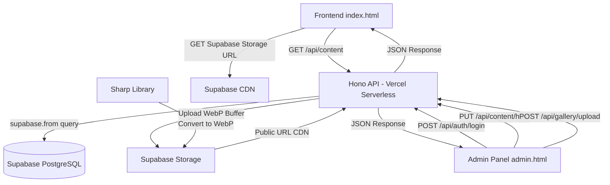
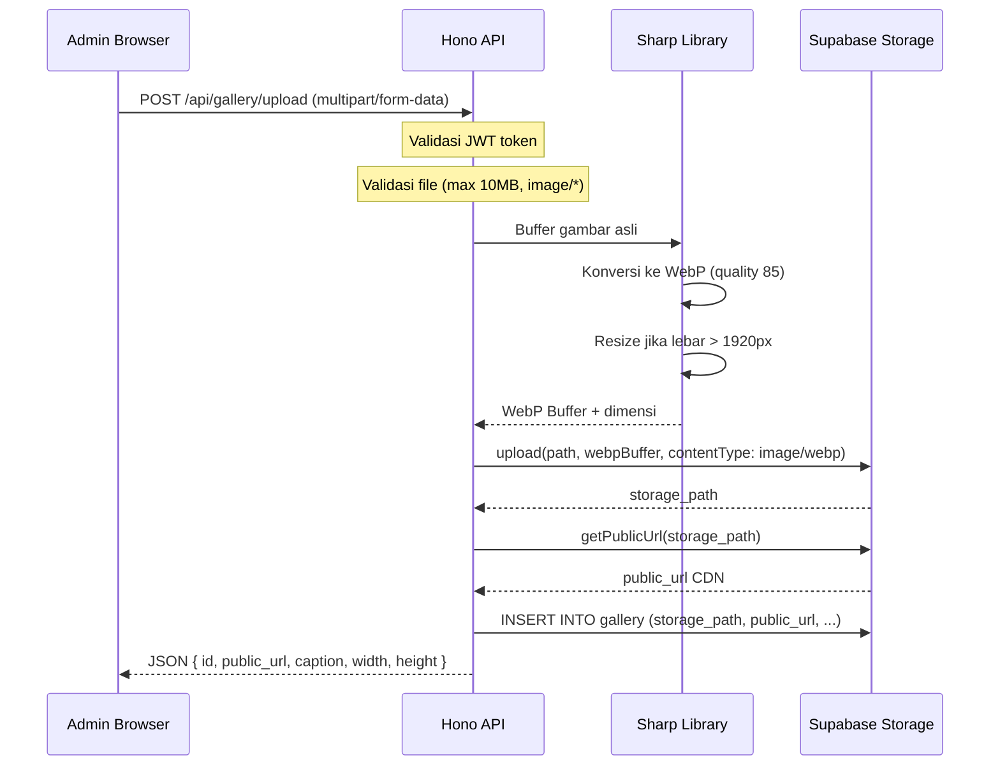
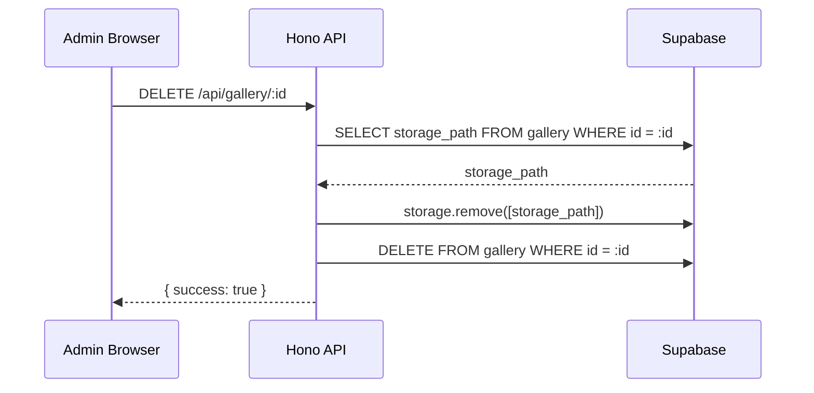

# Rencana Arsitektur Backend – Rumah Belajar Mentari

## Stack yang Dipilih

| Layer | Teknologi | Alasan |
|---|---|---|
| Backend Runtime | Node.js + Hono | Ringan, cepat, cocok untuk Vercel serverless |
| Database | **Supabase PostgreSQL** | Gratis 500MB, built-in Auth, Storage, Realtime |
| Image Storage | **Supabase Storage** | Terintegrasi langsung, gratis 1GB, CDN |
| Image Conversion | Sharp (Node.js) | Konversi ke WebP sangat cepat, kualitas tinggi |
| Auth | **Supabase Auth** atau JWT manual | Bisa pakai bawaan Supabase atau custom JWT |
| Deploy | Vercel | Gratis, serverless functions, CI/CD otomatis |
| Client | **@supabase/supabase-js** | SDK resmi, mudah digunakan |

> **Keuntungan Supabase vs Neon:**
> Supabase adalah platform all-in-one: PostgreSQL + Storage + Auth + Realtime dalam satu dashboard.
> Tidak perlu Cloudinary terpisah karena Supabase Storage sudah bisa menyimpan gambar dengan CDN.
> Gratis tier lebih besar: 500MB DB + 1GB Storage + 50MB file upload.

---

## Perbandingan Neon vs Supabase

| Fitur | Neon | Supabase |
|---|---|---|
| PostgreSQL | ✅ Serverless | ✅ Managed |
| Storage gambar | ❌ Perlu Cloudinary | ✅ Built-in (1GB gratis) |
| Auth bawaan | ❌ | ✅ (email, OAuth, dll) |
| Dashboard UI | Minimal | ✅ Lengkap (Table Editor, SQL Editor) |
| SDK Client | Drizzle/Prisma | ✅ @supabase/supabase-js |
| Gratis DB | 0.5GB | 500MB |
| Gratis Storage | ❌ | 1GB |
| CDN gambar | ❌ | ✅ via Supabase CDN |

---

## Arsitektur Sistem (dengan Supabase)



---

## Struktur Folder Proyek

```
mentari-bio/
├── api/                        ← Vercel serverless functions
│   ├── auth/
│   │   ├── login.js            ← POST /api/auth/login
│   │   └── change-password.js  ← POST /api/auth/change-password
│   ├── content/
│   │   ├── index.js            ← GET /api/content (semua data publik)
│   │   ├── hero.js             ← PUT /api/content/hero
│   │   ├── about.js            ← PUT /api/content/about
│   │   ├── programs.js         ← GET/PUT /api/content/programs
│   │   ├── schedule.js         ← GET/PUT /api/content/schedule
│   │   ├── location.js         ← PUT /api/content/location
│   │   ├── links.js            ← PUT /api/content/links
│   │   ├── testimonials.js     ← GET/PUT /api/content/testimonials
│   │   └── footer.js           ← PUT /api/content/footer
│   └── gallery/
│       ├── index.js            ← GET /api/gallery
│       ├── upload.js           ← POST /api/gallery/upload (multipart)
│       └── [id].js             ← DELETE/PUT /api/gallery/:id
├── lib/
│   ├── supabase.js             ← Supabase client (server-side)
│   ├── auth.js                 ← JWT helper (sign, verify, bcrypt)
│   └── image.js                ← Sharp WebP conversion helper
├── index.html
├── admin.html
├── script.js
├── admin.js
├── style.css
├── admin.css
├── vercel.json
└── package.json
```

---

## Database Schema (Supabase PostgreSQL)

```sql
-- Tabel admin credentials
CREATE TABLE admin_users (
  id UUID DEFAULT gen_random_uuid() PRIMARY KEY,
  username VARCHAR(50) UNIQUE NOT NULL,
  password_hash VARCHAR(255) NOT NULL,  -- bcrypt hash
  created_at TIMESTAMPTZ DEFAULT NOW()
);

-- Tabel konten (key-value JSON per kategori)
CREATE TABLE site_content (
  key VARCHAR(50) PRIMARY KEY,   -- 'hero', 'about', 'location', dll
  value JSONB NOT NULL,
  updated_at TIMESTAMPTZ DEFAULT NOW()
);

-- Tabel program belajar
CREATE TABLE programs (
  id UUID DEFAULT gen_random_uuid() PRIMARY KEY,
  level VARCHAR(10) NOT NULL,
  title VARCHAR(100) NOT NULL,
  subtitle VARCHAR(100),
  subjects TEXT[],
  is_featured BOOLEAN DEFAULT FALSE,
  sort_order INT DEFAULT 0,
  created_at TIMESTAMPTZ DEFAULT NOW()
);

-- Tabel jadwal belajar
CREATE TABLE schedules (
  id UUID DEFAULT gen_random_uuid() PRIMARY KEY,
  day VARCHAR(50) NOT NULL,
  time VARCHAR(50) NOT NULL,
  description VARCHAR(100),
  sort_order INT DEFAULT 0
);

-- Tabel galeri
CREATE TABLE gallery (
  id UUID DEFAULT gen_random_uuid() PRIMARY KEY,
  storage_path TEXT NOT NULL,    -- path di Supabase Storage
  public_url TEXT NOT NULL,      -- URL CDN publik
  caption VARCHAR(200),
  width INT,
  height INT,
  file_size INT,
  sort_order INT DEFAULT 0,
  created_at TIMESTAMPTZ DEFAULT NOW()
);

-- Tabel testimoni
CREATE TABLE testimonials (
  id UUID DEFAULT gen_random_uuid() PRIMARY KEY,
  text TEXT NOT NULL,
  author_name VARCHAR(100) NOT NULL,
  author_role VARCHAR(100),
  stars SMALLINT DEFAULT 5 CHECK (stars BETWEEN 1 AND 5),
  sort_order INT DEFAULT 0,
  created_at TIMESTAMPTZ DEFAULT NOW()
);
```

---

## Supabase Storage Setup

Buat bucket bernama `gallery` di Supabase Storage:
- **Public bucket** → gambar bisa diakses langsung via URL CDN
- Path format: `gallery/{timestamp}-{random}.webp`
- URL format: `https://{project}.supabase.co/storage/v1/object/public/gallery/{filename}`

---

## Alur Upload Gambar → WebP (dengan Supabase Storage)



---

## Alur Hapus Gambar



---

## API Endpoints

### Auth
| Method | Endpoint | Deskripsi | Auth |
|---|---|---|---|
| POST | `/api/auth/login` | Login admin, return JWT | ❌ |
| POST | `/api/auth/change-password` | Ganti password | ✅ JWT |

### Content (Publik)
| Method | Endpoint | Deskripsi | Auth |
|---|---|---|---|
| GET | `/api/content` | Ambil semua konten sekaligus | ❌ |
| GET | `/api/gallery` | Ambil semua foto galeri | ❌ |

### Content (Admin)
| Method | Endpoint | Deskripsi | Auth |
|---|---|---|---|
| PUT | `/api/content/hero` | Update hero section | ✅ JWT |
| PUT | `/api/content/about` | Update about section | ✅ JWT |
| GET/PUT | `/api/content/programs` | CRUD program belajar | ✅ JWT |
| GET/PUT | `/api/content/schedule` | CRUD jadwal | ✅ JWT |
| PUT | `/api/content/location` | Update lokasi | ✅ JWT |
| PUT | `/api/content/links` | Update tautan | ✅ JWT |
| GET/PUT | `/api/content/testimonials` | CRUD testimoni | ✅ JWT |
| PUT | `/api/content/footer` | Update footer | ✅ JWT |

### Gallery
| Method | Endpoint | Deskripsi | Auth |
|---|---|---|---|
| POST | `/api/gallery/upload` | Upload gambar → WebP → Supabase Storage | ✅ JWT |
| DELETE | `/api/gallery/:id` | Hapus foto dari DB + Storage | ✅ JWT |
| PUT | `/api/gallery/:id` | Update caption / urutan | ✅ JWT |

---

## Environment Variables (`.env`)

```env
# Supabase
SUPABASE_URL=https://xxxxxxxxxxxx.supabase.co
SUPABASE_SERVICE_ROLE_KEY=eyJhbGciOiJIUzI1NiIsInR5cCI6IkpXVCJ9...
# (gunakan service_role key di server, BUKAN anon key)

# JWT untuk admin panel
JWT_SECRET=your-super-secret-key-min-32-chars
JWT_EXPIRES_IN=8h
```

---

## Konfigurasi Vercel (`vercel.json`)

```json
{
  "rewrites": [
    { "source": "/api/(.*)", "destination": "/api/$1" }
  ],
  "functions": {
    "api/**/*.js": {
      "maxDuration": 30
    }
  }
}
```

---

## Dependencies (`package.json`)

```json
{
  "dependencies": {
    "hono": "^4.x",
    "@supabase/supabase-js": "^2.x",
    "sharp": "^0.33.x",
    "bcryptjs": "^2.x",
    "jsonwebtoken": "^9.x",
    "busboy": "^1.x"
  }
}
```

---

## Perubahan Frontend

### `script.js`
- Ganti `getData()` dari localStorage → `fetch('/api/content')`
- Gallery: `fetch('/api/gallery')` → render gambar dari `public_url` Supabase CDN

### `admin.js`
- Login: `fetch('/api/auth/login')` → simpan JWT di `sessionStorage`
- Setiap save: `fetch('/api/content/[kategori]', { method: 'PUT', headers: { Authorization: 'Bearer JWT' } })`
- Upload gambar: `fetch('/api/gallery/upload', { method: 'POST', body: FormData })` dengan `<input type="file">`
- Hapus gambar: `fetch('/api/gallery/:id', { method: 'DELETE' })`

### `admin.html`
- Input gallery: ganti dari URL text → **file input** (`<input type="file" accept="image/*">`)
- Tampilkan progress bar upload
- Preview gambar setelah upload berhasil

---

## Keamanan

- Password admin di-hash dengan **bcrypt** (cost factor 12)
- JWT expire dalam 8 jam, disimpan di `sessionStorage`
- Gunakan **service_role key** hanya di server (tidak pernah expose ke client)
- Validasi tipe file di server (magic bytes, bukan hanya extension)
- Rate limiting pada endpoint login
- RLS (Row Level Security) Supabase dinonaktifkan untuk tabel yang diakses via service_role

---

## Langkah Implementasi

1. **Buat proyek Supabase** di [supabase.com](https://supabase.com) → ambil URL + service_role key
2. **Jalankan SQL migration** di Supabase SQL Editor (schema di atas)
3. **Buat Storage bucket** `gallery` (public)
4. **Setup proyek Node.js** — `npm init`, install dependencies
5. **Buat `lib/supabase.js`** — Supabase server client
6. **Buat `lib/auth.js`** — JWT sign/verify + bcrypt
7. **Buat `lib/image.js`** — Sharp WebP conversion helper
8. **Buat API endpoints** — Auth, content, gallery
9. **Update `admin.js`** — Ganti localStorage → API calls + file upload
10. **Update `script.js`** — Ganti localStorage → fetch API
11. **Update `admin.html`** — Ganti URL input → file input untuk gallery
12. **Deploy ke Vercel** — Set environment variables di Vercel dashboard
13. **Seed database** — Insert data default via Supabase Table Editor atau SQL
